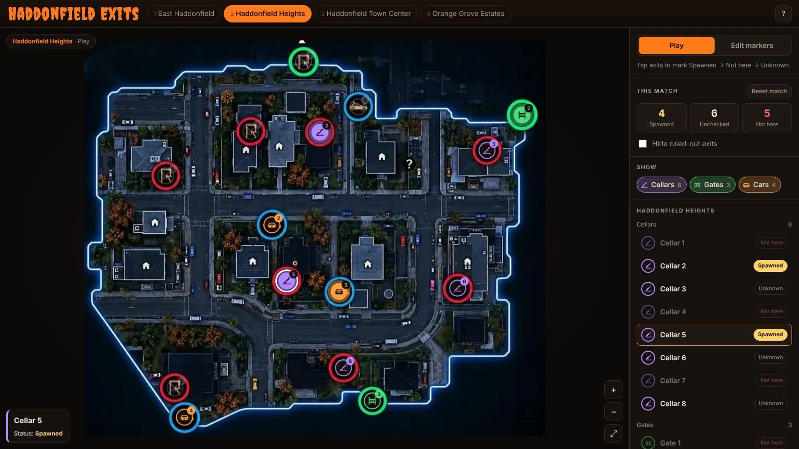

# 🎃 Haddonfield Exits

An interactive exit map for **Halloween: The Game**. It shows every possible escape spawn on all four maps, and you can track which ones actually showed up in your current match.



It's a single static page with no build step, no framework and no backend. You can host it anywhere.

---

## Features

- **All four maps:** East Haddonfield, Haddonfield Heights, Haddonfield Town Center and Orange Grove Estates.
- **Every exit type:** storm cellars, escape gates and cars, each with its own color and icon.
- **Match tracking:** tap an exit to cycle it through **Spawned → Not here → Unknown**. A tally shows your progress, and you can hide ruled-out exits as you scout. **Reset match** clears everything for the next round.
- **Filters:** show or hide cellars, gates or cars with one click.
- **Smooth navigation:** scroll-wheel zoom, drag to pan, and pinch-zoom on phones and tablets. Click any exit in the sidebar to fly to it.
- **Built-in editor:** place, drag, retype and delete exits, and add notes such as "needs key" or "behind the blue house." Drop in a new map screenshot whenever the game updates.
- **Works on mobile:** on small screens the sidebar moves below the map.
- **Keyboard shortcuts** for everything (see below).

## Exit counts

These are possible spawn locations. Each match only uses some of them.

| Map | Storm Cellars | Escape Gates | Cars |
|---|:-:|:-:|:-:|
| East Haddonfield | 5 | 1 | 4 |
| Haddonfield Heights | 8 | 3 | 4 |
| Haddonfield Town Center | 3 | 1 | 4 |
| Orange Grove Estates | 4 | 3 | 5 |

## How to use

### Play mode
1. Pick your map from the tabs at the top, or press <kbd>1</kbd>–<kbd>4</kbd>.
2. As you find exits in-game, tap them on the map:
   - **Once:** Spawned (highlighted and pulsing)
   - **Twice:** Not here (dimmed and crossed out)
   - **Three times:** back to Unknown
3. Turn on **Hide ruled-out exits** to see only what's left.
4. Press **Reset match** (or <kbd>R</kbd>) when the round ends.

### Edit mode
1. Click **Edit markers**, or press <kbd>E</kbd>.
2. Choose a type (<kbd>C</kbd> cellar, <kbd>G</kbd> gate, <kbd>V</kbd> vehicle), then click the map to place an exit.
3. Drag markers to move them. Select one to change its type, add a note, or delete it.
4. To change a map image, drag a screenshot onto the map or use **Upload image**.

Edits save in your browser only. To publish them for everyone, click **Export exits.json** and commit that file to this repo (see [Updating exits](#updating-exits)).

### Keyboard shortcuts

| Key | Action |
|---|---|
| <kbd>1</kbd>–<kbd>4</kbd> | Switch map |
| <kbd>E</kbd> | Toggle edit mode |
| <kbd>C</kbd> / <kbd>G</kbd> / <kbd>V</kbd> | Edit mode: place cellar / gate / vehicle |
| <kbd>Delete</kbd> | Edit mode: delete the selected exit |
| <kbd>F</kbd> | Fit the map to the screen |
| <kbd>+</kbd> / <kbd>−</kbd> | Zoom in / out |
| <kbd>R</kbd> | Reset match tracking |
| <kbd>Esc</kbd> | Deselect |
| <kbd>?</kbd> | Help |

## Project structure

```
.
├── index.html        # The whole app: HTML, CSS and JS in one file
├── exits.json        # Exit positions for every map (the hosted source of truth)
├── maps/
│   ├── east-haddonfield.webp
│   ├── haddonfield-heights.webp
│   ├── town-center.webp
│   └── orange-grove.webp
└── docs/
    └── preview.webp  # README screenshot
```

Exit positions are stored as **percentages** of each map image, so markers stay in place at any zoom level or screen size.

## Hosting

### Cloudflare Pages
1. Push this repo to GitHub.
2. In the Cloudflare dashboard, go to **Workers & Pages → Create → Pages → Connect to Git** and select this repo.
3. Use these build settings:
   - **Framework preset:** None
   - **Build command:** *(leave empty)*
   - **Build output directory:** *(leave empty, or `/`)*
4. Deploy. Every push to the main branch redeploys automatically.

### GitHub Pages
Go to **Settings → Pages**, set the source to your main branch and the `/ (root)` folder, then save.

### Running locally
Open `index.html` directly in a browser. The exit data is also embedded in the page, so it works without a server.

To test loading `exits.json` the way a host serves it, run a local server:

```bash
python3 -m http.server 8000
# then open http://localhost:8000
```

## Updating exits

1. Open the live site and switch to **Edit markers**.
2. Make your changes.
3. Click **Export exits.json**.
4. Replace `exits.json` in this repo with the exported file, then commit and push.

When the site is hosted, `exits.json` takes priority over the copy embedded in `index.html`. If you also want the embedded copy (used when opening the file locally) to match, paste the exported JSON into the `EMBEDDED` constant near the top of the script in `index.html`.

To replace a map image, overwrite the file in `maps/` with a new screenshot. Use the same framing as the old one, or realign the markers in Edit mode afterwards.

## Credits

- Exit locations and counts were cross-checked against the [Mobalytics escape location guide](https://mobalytics.gg/gamebase/guides/halloween-the-game-all-map-escape-locations).
- The map images are community-made annotated screenshots of the in-game maps.

## Disclaimer

This is an unofficial fan project. It is not affiliated with, endorsed by, or connected to the developers, publishers or rights holders of *Halloween: The Game* or the *Halloween* franchise. All game names, maps and related assets belong to their respective owners.
